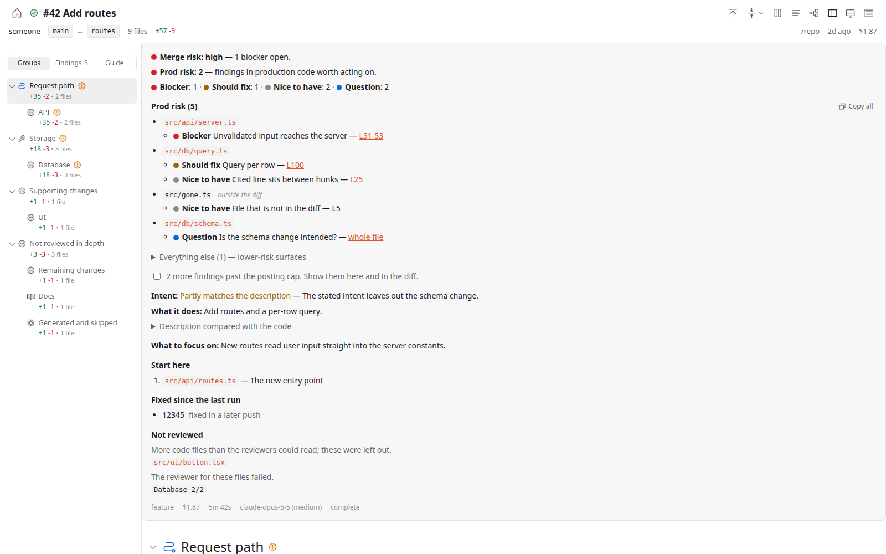
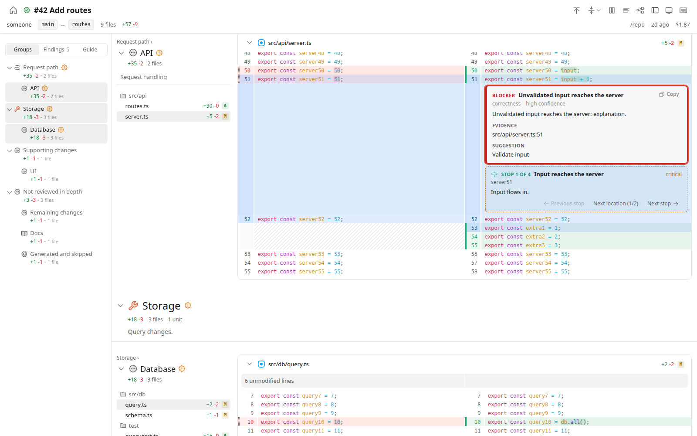

# DiffLoupe

Understand your diffs before you merge them.

DiffLoupe runs a multi-agent AI code review over a local change or a GitHub pull request. You read the result in a local web UI: the changed files are grouped by what they do, the findings sit next to the lines they are about, and a walkthrough tells you where to start reading.

It is also a plain diff viewer. `diffloupe diff` shows the same grouped diff in about a second, with no agents and no credentials, and can add a walkthrough from a single model call.





<sub>Screenshots use a synthetic test fixture, not a real repository.</sub>

## How a review works

1. **Group.** The changed files are grouped into review units from links in the code: a name defined in one file and used in another, a test and its source, an import, a shared directory. Generated and lock files are skipped. Docs are listed but not reviewed in depth.
2. **Review.** Each unit gets its own reviewer agent, which reads the surrounding code with [tilth](https://github.com/jahala/tilth) and reports findings with evidence. Up to six run at once.
3. **Coordinate.** A coordinator merges and deduplicates the findings, drops the ones it cannot verify, and checks the change against its stated intent: the PR description, `--intent`, or the commit messages.
4. **Walk through.** A walkthrough pass orders the change into chapters and stops, with a "start here" list.

Each review is saved as a run that you can list and reopen. Reviewing the same target again links the new run to the previous one: findings that were fixed are listed as fixed, and ones still open are carried forward instead of being reported again.

## The web UI

- **Summary** at the top, laid out like a GitHub review comment: merge risk and production risk, finding counts, findings grouped by file with links to their lines, whether the change matches its stated intent, what to focus on, and where to start.
- **Groups** in the sidebar and down the page. Each group has a short summary and its own file tree. Files can be collapsed one by one or from the collapse menu.
- **File tree notes:** under each file in a group's tree, one row per finding (severity dot, title, line) and per walkthrough stop (signpost icon, title, stop number, line). Clicking a row scrolls to its line. Groups with a blocker or should-fix finding, or a critical walkthrough stop, get an orange mark; its tooltip says which.
- **Finding cards** under the lines they refer to, coloured by severity, with explanation, evidence and a suggested fix. Focusing a finding highlights its line range.
- **Walkthrough stops** as separate cards, with a Guide mode in the sidebar for stepping through them in order.
- **Copy** on each finding and **Copy all** put the findings on the clipboard as markdown, ready to paste into a coding agent.
- **Keyboard:** `j`/`k` next/previous file, `n`/`p` next/previous finding, `]`/`[` next/previous stop, `x` collapse the current file, `t` back to the summary, `?` for the list. Browser Back and Forward move between the findings you jumped to.
- Split or unified diffs, line wrapping, light and dark themes.
- While a review is running, the page shows its progress and fills in the file groups as soon as grouping finishes.
- The run list at `/` shows every saved run, with a filter for reviews or diffs.

## Requirements

| Tool | Notes |
|------|-------|
| [Bun](https://bun.sh) 1.3 or later | Runs the CLI and the server. |
| `git` | |
| [OpenCode](https://opencode.ai) 2.x | Runs every agent (`npm i -g opencode-ai`). Tested with 2.0.26. DiffLoupe writes its own OpenCode config for each run, so your agents, plugins and MCP servers are not used. Your default model and your `providers` block are. |
| [tilth](https://github.com/jahala/tilth) | Code reading tools for the reviewers (`cargo install tilth`). Tested with 0.9.0. |
| [`gh`](https://cli.github.com) | Only for pull requests. Run `gh auth login` first. |
| A model provider credential | See [Credentials](#credentials). |

`diffloupe diff` needs only Bun, `git`, and `gh` for pull requests. With `--walkthrough` it also needs OpenCode and a credential for the walkthrough model, but not tilth.

Run `diffloupe doctor` to check all of this, along with which models a review will use and where each credential comes from.

**Cost.** With the built-in defaults (Claude Opus 5.5 for the reviewers and the coordinator, Claude Sonnet 5.5 for the walkthrough and group naming), real runs so far cost about $0.10 for a one-file commit, about $1 for a small PR, and $4–5 for a large one. If your OpenCode config sets a default model, DiffLoupe uses it for every stage instead, which changes the cost. Use `--max-cost` or `maxCostUsd` to set a limit. The run page and `diffloupe runs` show what each run cost. Models whose provider reports no price show "cost not reported", and `--max-cost` cannot be enforced for them.

**Platforms.** Developed and tested on Linux and WSL2. On WSL the server binds `127.0.0.1` and the Windows browser reaches it through `localhost`. macOS should work but has not been tried. Native Windows is not supported; use WSL.

## Install

```bash
bun add -g @acemarke/diffloupe
```

`npm i -g @acemarke/diffloupe` works too, but the `diffloupe` command runs under Bun either way, so Bun must be on your `PATH`. The package is a self-contained bundle with no runtime dependencies.

To run from source instead:

```bash
git clone https://github.com/markerikson/diffloupe.git
cd diffloupe
bun install
bun run build
```

Then run `bun /path/to/diffloupe/dist/index.js`, or put a `diffloupe` alias or wrapper script on your `PATH` that runs it.

## Quick start

```bash
# Review uncommitted changes in the current repo and open the result in a browser
diffloupe review --open

# Review a GitHub PR; its title and description are the stated intent
diffloupe review '#123' --open
diffloupe review https://github.com/owner/repo/pull/123 --open

# Review a branch against its merge base, with a stated intent and a cost limit
diffloupe review branch:my-feature --intent "Add rate limiting to API endpoints" --max-cost 3

# Run in the terminal only and print the review as markdown
diffloupe review --headless --markdown

# View uncommitted changes grouped by code links, with no model calls
diffloupe diff --open

# View a PR with a walkthrough guide (one model call)
diffloupe diff '#123' --walkthrough --open

# View a PR from any directory, without a clone
diffloupe diff owner/repo#123 --open

# Reopen saved runs
diffloupe open --last --open
diffloupe runs
```

`review` and `diff` start a local server, print the run URL, and stream progress to the terminal. The page can be opened right away. Ctrl+C stops the server, and cancels the run if it is still going. If a `diffloupe serve` is already running, `review`, `diff` and `open` use it instead of starting another server.

## Commands

### `diffloupe review [target]`

**Targets:**

| Target | Description |
|--------|-------------|
| `worktree` | Staged, unstaged and untracked changes against HEAD (default) |
| `staged` | Staged changes against HEAD |
| `<sha>`, `HEAD`, `HEAD~2`, `main^`, a tag, `commit:<rev>` | A single commit against its parent. Use `commit:<branch>` for just the tip commit of a branch |
| `<a>..<b>`, `range:<a>..<b>` | The diff between two commits. An empty side means `HEAD`, as in `HEAD~3..` |
| `<a>...<b>`, `range:<a>...<b>` | `<b>` against `merge-base(<a>, <b>)` |
| `<branch>`, `branch:<name>` | A branch against its merge base with the default branch. A bare name of the default branch means its tip commit |
| `#<n>`, `pr:<n>`, PR URL | A GitHub pull request, reviewed in a temporary worktree at the PR head |

**Options:**

| Option | Description |
|--------|-------------|
| `-C, --repo <path>` | Repository to review (default: current directory) |
| `--base <ref>` | For `staged`/`worktree`: diff against `merge-base(<ref>, HEAD)` instead of HEAD |
| `-i, --intent <text>` | Describe the intent of the changes |
| `--intent-file <path>` | Read the intent from a file |
| `--model <stage=id>` | Model for a stage: `review`, `coordinator`, `walkthrough` (repeatable) |
| `--effort <level>` | Reasoning effort: `low`, `medium`, `high` |
| `--config <file>` | Per-repo review settings (see below) |
| `--max-cost <usd>` | Stop starting new review slices once spending reaches this amount. Slices already running finish, so the total can go over: by up to six slices at $3 each, plus the coordinator and walkthrough. |
| `--host <host>`, `--port <port>` | Server address (default `127.0.0.1:4517`, or the next free port) |
| `--open` | Open the run in a browser. On WSL this opens the Windows browser. |
| `--headless` | Run without a server and print a summary to stdout |
| `--markdown` | With `--headless`, print the full review markdown instead of the summary |

Untracked files over 1 MB are skipped and listed in the run.

### `diffloupe diff [target]`

Shows a target's diff in the web UI, grouped the same way as a review, with no review agents. It takes the same targets as `review`. Grouping reads files from git objects, so no worktree is created and your checkout is not touched. Group titles come from the files' directories and names instead of a model call. Docs and generated files go in the trailing "Other changes" section.

| Option | Description |
|--------|-------------|
| `-C, --repo <path>` | Repository (default: current directory) |
| `--base <ref>` | For `staged`/`worktree`: diff against `merge-base(<ref>, HEAD)` instead of HEAD |
| `--walkthrough` | Add the walkthrough guide: one call to the walkthrough model, which works from the diff alone and gets no tools for reading the repo |
| `-i, --intent <text>`, `--intent-file <path>` | Stated intent, used by the walkthrough |
| `--model walkthrough=<id>`, `--effort <level>` | Walkthrough model and effort |
| `--config <file>` | Per-repo settings, for the walkthrough model |
| `--host`, `--port`, `--open` | As for `review` |
| `--headless` | Print the groups and their files to stdout, no server |

`owner/repo#<n>` and PR URLs also work outside a clone of that repository. DiffLoupe then keeps its own copy of the repository under `~/.local/share/diffloupe/repos/` with no history and no file contents: each run fetches only the PR head and its merge base, and file contents are fetched as the diff and grouping need them. git authenticates through `gh`, so private repositories work too. Such runs cannot be turned into reviews, since a review needs a clone.

A diff run page has a **Review these changes** button. It starts a full review of the same base and head commits. For `worktree` and `staged` targets that is the snapshot you were looking at, not what is on disk now.

### `diffloupe open [runId]`

Prints the URL of a saved run, starting a server if none is running. `--last` opens the most recent run; with no run id it opens the run list. `--open` opens the browser. `--port` is where it looks for a running server (default 4517), and `--host` is the address a new server listens on.

### `diffloupe serve`

Runs the server until you stop it. `-C` sets the repository that runs use by default. `--host`, `--port` and `--open` work as for `review`.

### `diffloupe runs`

| Command | Description |
|---------|-------------|
| `diffloupe runs [--kind review\|diff] [--json]` | List saved runs, newest first |
| `diffloupe runs show <id> [--json]` | Show a run: groups with their files and findings, walkthrough stops, totals |
| `diffloupe runs show <id> --markdown [--over-cap]` | Print the findings as markdown, the same text as Copy all in the UI |
| `diffloupe runs rm <id>` | Delete a run, its artifacts, its scratch files and the git refs that pin its commits |
| `diffloupe runs prune [--older-than 30d] [--keep 20] [--kind review\|diff] [--yes]` | Delete runs older than the cutoff, except the newest `--keep`, plus scratch files no run owns. Lists what it would delete unless `--yes` is given |

Runs are stored under `$XDG_DATA_HOME/diffloupe/runs/<id>/` (`~/.local/share/diffloupe/runs/` by default). Each holds `run.json`, the reviewed `diff.patch`, the progress log, and the raw review output. Deleting a run removes the refs that pin its commits; the repository copies under `repos/` are not deleted, and their objects stay until you remove the directory.

### `diffloupe doctor`

Checks Bun, git, OpenCode, tilth and `gh`; prints the model for each stage and where it came from, and the source of each provider credential; and shows how much disk the data directory uses. Exits non-zero if a review could not run. `--config <file>` includes a per-repo settings file in the model lookup.

## Configuration

**User config:** `~/.config/diffloupe/config.json`

```json
{
  "provider": "anthropic",
  "models": { "review": "claude-opus-5-5", "coordinator": "claude-opus-5-5", "walkthrough": "claude-sonnet-5-5" },
  "effort": "medium",
  "apiKeys": { "anthropic": "sk-ant-..." },
  "opencode": { "useDefaultModel": true },
  "maxCostUsd": 5,
  "port": 4517,
  "host": "127.0.0.1"
}
```

**Per-repo settings** (`--config <file>`):

```json
{
  "provider": "anthropic",
  "models": { "review": "...", "coordinator": "...", "walkthrough": "..." },
  "effort": "medium",
  "surfaces": { "deploy": ["^infra/"], "tooling": ["^docs/"] },
  "extraExcludes": ["vendor/openssl/"],
  "instructions": [
    "## What failure looks like here",
    "A change that breaks runs already saved on disk.",
    "## Don't report",
    "Styling in src/web/."
  ]
}
```

Every field is optional.

| Setting | User config | Per-repo settings | CLI | Environment | Default |
|---------|-------------|-------------------|-----|-------------|---------|
| Reviewer model | `models.review` | `models.review` | `--model review=<id>` | `REVIEW_MODEL` | OpenCode default model, else `anthropic/claude-opus-5-5` |
| Coordinator model | `models.coordinator` | `models.coordinator` | `--model coordinator=<id>` | `REVIEW_MODEL_MERGE` | OpenCode default model, else `anthropic/claude-opus-5-5` |
| Walkthrough model | `models.walkthrough` | `models.walkthrough` | `--model walkthrough=<id>` | `REVIEW_MODEL_WALK` | OpenCode default model, else `anthropic/claude-sonnet-5-5` |
| Provider for bare model ids | `provider` | `provider` | | `REVIEW_PROVIDER` | `anthropic` |
| Effort | `effort` | `effort` | `--effort` | `REVIEW_EFFORT`, `REVIEW_EFFORT_AUX` | `medium` for built-in default models only |
| Use the OpenCode default model | `opencode.useDefaultModel` | | | | `true` |
| API keys by provider id | `apiKeys.<provider>` | | | | |
| Cost limit (USD) | `maxCostUsd` | | `--max-cost` | | none |
| Server address | `host`, `port` | | `--host`, `--port` | | `127.0.0.1:4517` |

**Model lookup.** Each stage is looked up on its own. `REVIEW_*` environment variables win, then command-line options, then the per-repo settings file, then the user config, then the `model` in your global OpenCode config (`~/.config/opencode/opencode.json(c)`), then the built-in defaults. A model id without a `/` gets the provider prefix, so `claude-opus-5-5` means `anthropic/claude-opus-5-5`.

**Effort** is passed to OpenCode as the model variant (`provider/model#high`), so it must be a variant the model offers. It is only added when you set it, or when the model is a built-in default. A model from your OpenCode config runs without a variant unless you set an effort. A `#variant` written in the model id always wins.

`surfaces` are regex sources matched against repo-relative paths. They decide which findings count toward "prod risk": anything not matched as deploy or tooling counts as product code. `extraExcludes` are path substrings left out of the code map.

`instructions` is free text given to every reviewer and the coordinator, either one string or an array of lines. Keep it short and about what the code can't tell a reviewer: what counts as breaking in this repo, invariants that are easy to break and invisible in a diff, and what not to report. Where it conflicts with the built-in review guidance, it wins.

### Credentials

Each review agent runs OpenCode with its own data directory, so DiffLoupe has to hand it a credential for every provider the chosen models use. For each provider, the first of these that exists is used:

1. The provider's environment variable, such as `ANTHROPIC_API_KEY` or `OPENAI_API_KEY`. A `providers.<id>.env` list in your OpenCode config is honored.
2. `apiKeys.<provider>` in `~/.config/diffloupe/config.json`. It is passed to the OpenCode processes only, not to DiffLoupe's own environment.
3. An API key you saved with `opencode auth login`. DiffLoupe reads it with `opencode auth export` and imports it into each agent's data directory, which is deleted when the agent exits.

OAuth logins (such as a Claude or ChatGPT subscription) are not shared with the agents; use an API key for those providers. Providers that authenticate from the machine, such as Amazon Bedrock, Google Vertex, Ollama and LM Studio, are not checked. If a provider has no credential, the review stops before it starts and names the provider, the stage, and the ways to add one.

The `diffloupe` command does not load `.env` files, so a `.env` in the repo you review cannot supply or override a key. `diffloupe doctor` shows which source each provider's credential comes from.

## Inspirations

- [pulls.review](https://pulls.review) - the page layout: grouped files, sticky group panels, per-group file trees
- [Codiff](https://github.com/nkzw-tech/codiff): a diff viewer with walkthroughs
- [`@pierre/diffs`](https://diffs.com) - the diff renderer
- [Plannotator](https://github.com/backnotprop/plannotator) - local review server, browser opening and request guards
- [LaReview](https://github.com/puemos/lareview) - flow-based grouping
- [GitHuman](https://github.com/mcollina/githuman) - pre-commit review
- [Diffray](https://github.com/diffray/diffray) - validation patterns, confidence scoring
- [Critique](https://github.com/remorses/critique) - prompt engineering principles
- [CodeRabbit](https://coderabbit.ai) - incremental review

## Development

```bash
bun install
bun run dev        # CLI from source, in watch mode
bun run dev:web    # Vite dev server for the web UI on :5173, proxying /api to a server on :4517
bun test src       # unit tests
bun run typecheck
bun run lint
bun run build      # CLI bundle plus the web UI in dist/web
```

The server serves the web UI from `dist/web`, so after changing web code, `bun run build:web` and a page reload are enough.

**Tech stack:** Bun, TypeScript, Commander, ArkType, Hono, React, Redux Toolkit, TanStack Router, `@pierre/diffs`

## License

MIT
